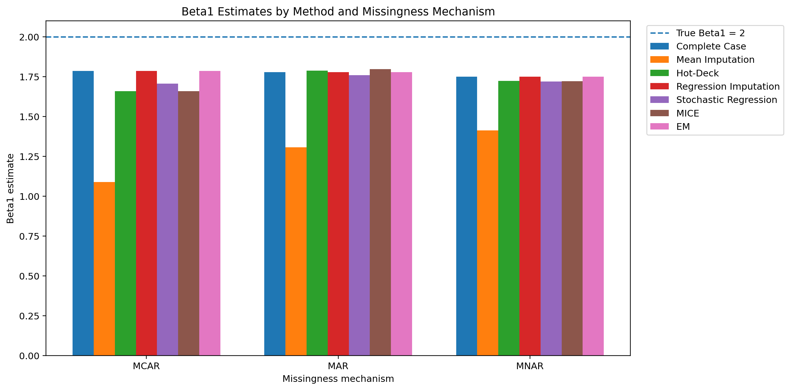

# Missing Data & Statistical Inference

### Comparing regression inference under MCAR, MAR, and MNAR

This project uses a controlled simulation to study a practical statistical question:

> **When the response variable contains missing values, how do different missing-data handling methods affect regression estimates and their uncertainty?**

The focus is on **comparing methods within each missingness mechanism** rather than treating MCAR, MAR, and MNAR themselves as methods to be ranked.

> **Newer version:** an extended study (200 observations, missing values in two variables, a helper variable, eight methods, 300 simulated repetitions) is in [`extended_study/`](extended_study/). See its [report](extended_study/report/Missing_Data_Statistical_Inference_Report.pdf). The description below is the original study.

---

## Project overview

A complete dataset of 100 observations is generated from the multiple linear regression model

$$
Y = 5 + 2X_1 - 1.5X_2 + X_3 + \epsilon
$$

so the true regression coefficients are

$$
\beta_0 = 5, \qquad
\beta_1 = 2, \qquad
\beta_2 = -1.5, \qquad
\beta_3 = 1.
$$

Only **$Y$ is made incomplete**. The predictors $X_1$, $X_2$, and $X_3$ remain fully observed.

Three missingness mechanisms are then imposed on the same underlying complete dataset:

- **MCAR — Missing Completely At Random:** missingness is generated independently of the variables.
- **MAR — Missing At Random:** missingness depends on observed information, here $X_1$.
- **MNAR — Missing Not at Random:** missingness depends on the underlying outcome $Y$ itself.

For each mechanism, the **same incomplete dataset** is given to all seven methods so that the methods are compared under the same missing-data condition.

---

## Methods

The project compares seven approaches:

| Method | Basic idea |
|---|---|
| **Complete Case** | Remove observations where $Y$ is missing and fit the regression to the remaining cases. |
| **Mean Imputation** | Replace missing $Y$ values with the observed mean of $Y$. |
| **Hot-Deck** | Use a similar observed case as a donor and copy its observed $Y$. |
| **Regression Imputation** | Predict missing $Y$ from $X_1,X_2,X_3$ using a regression model. |
| **Stochastic Regression** | Add sampled regression residuals to the predicted missing values. |
| **MICE / PMM** | Generate multiple imputations using predictive mean matching and pool the resulting estimates. |
| **EM** | Estimate the regression parameters iteratively using the Expectation-Maximization framework. |

---

## What is evaluated?

The main parameter of interest is **$\beta_1$**, whose true value is 2.

For every method and mechanism, the project examines:

- **Point estimate:** $\hat\beta_1$
- **Bias:** $\hat\beta_1 - \beta_1$
- **Bootstrap standard error**
- **95% confidence interval**

For MICE, inference is pooled across multiple completed datasets using **Rubin's rules**, combining within-imputation and between-imputation variability.

---

## Results

The simulation shows clear differences in how the handling methods affect the estimated coefficient.

For example, the estimated $\beta_1$ from mean imputation was:

| Mechanism | $\hat\beta_1$ | Bias |
|---|---:|---:|
| MCAR | 1.089 | -0.911 |
| MAR | 1.307 | -0.693 |
| MNAR | 1.413 | -0.587 |

Under MAR, the MICE pooled result was

$$
\hat\beta_1 = 1.797,
\qquad SE = 0.094,
$$

with a 95% confidence interval of

$$
(1.612,\;1.982).
$$

Under MNAR, the corresponding MICE result was

$$
\hat\beta_1 = 1.722,
\qquad SE = 0.108,
$$

with a 95% confidence interval of

$$
(1.510,\;1.933).
$$

The complete method-by-mechanism results are available in the repository.

---

## Files

| Resource | Description |
|---|---|
| [Main notebook](notebooks/missing_data_statistical_inference.ipynb) | Complete simulation, missingness setup, seven methods, bootstrap analysis, results and visualisations |
| [Final report (PDF)](report/Missing_Data_Statistical_Inference_Final_Report%20%285%29.pdf) | Full project report |
| [LaTeX source](report/Missing_Data_Statistical_Inference_Final_Report.tex) | Source used to prepare the report |
| [Master results](results/master_results.csv) | Method-by-mechanism estimates, standard errors, confidence intervals and bias |
| [MICE results](results/mice_details.csv) | Individual imputation estimates and pooled MICE quantities |

### Figures

[Overall $\beta_1$ comparison](figures/beta1_estimates_by_mechanism.png) ·
[MCAR confidence intervals](figures/beta1_ci_mcar.png) ·
[MAR confidence intervals](figures/beta1_ci_mar.png) ·
[MNAR confidence intervals](figures/beta1_ci_mnar.png)

[MCAR absolute bias](figures/beta1_absolute_bias_mcar.png) ·
[MAR absolute bias](figures/beta1_absolute_bias_mar.png) ·
[MNAR absolute bias](figures/beta1_absolute_bias_mnar.png)

---

## Repository structure

\`\`\`text
missing-data-stat-inference/
├── README.md
├── requirements.txt
├── .gitignore
├── notebooks/
│   └── missing_data_statistical_inference.ipynb
├── report/
│   ├── Missing_Data_Statistical_Inference_Final_Report (5).pdf
│   └── Missing_Data_Statistical_Inference_Final_Report.tex
├── figures/
│   ├── beta1_estimates_by_mechanism.png
│   ├── beta1_ci_mcar.png
│   ├── beta1_ci_mar.png
│   ├── beta1_ci_mnar.png
│   ├── beta1_absolute_bias_mcar.png
│   ├── beta1_absolute_bias_mar.png
│   └── beta1_absolute_bias_mnar.png
└── results/
    ├── master_results.csv
    └── mice_details.csv
\`\`\`

---

## Reproducibility

The analysis is implemented in **Python** using:

**NumPy · pandas · SciPy · statsmodels · Matplotlib · Jupyter**

The complete notebook contains the simulation setup, missingness generation, implementation of the seven methods, bootstrap inference, result storage, and visualisations.
