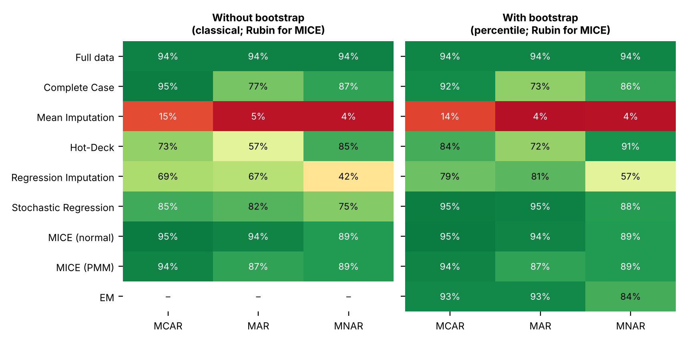

# Missing Data and Statistical Inference

A Monte Carlo study that compares **eight ways of handling missing values** in a regression, separately for the three kinds of missingness (**MCAR, MAR and MNAR**), and checks whether their **classical, bootstrap and Rubin confidence intervals** really contain the truth 95% of the time.

The data come from a model where the true answer is known (`Y = 5 + 2·X1 − 1.5·X2 + X3 + error`, so the slope of interest is **β₁ = 2**). About 20% of the values of `Y` and `X1` are deleted, and each method tries to recover the right answer and a trustworthy 95% interval.



**Read the full report:** [`report/Missing_Data_Statistical_Inference_Report.pdf`](report/Missing_Data_Statistical_Inference_Report.pdf)

**Study guide (the whole project explained from scratch, every figure explained, likely questions and answers):** [`report/Project_Explained_Step_by_Step.pdf`](report/Project_Explained_Step_by_Step.pdf)

## The question

> Within each type of missingness, which way of handling the missing values gives the most accurate estimate, and which confidence intervals contain the true value about 95% of the time?

## Design: the bootstrap runs inside the Monte Carlo

* **Monte Carlo:** 300 new datasets (n = 200) are drawn from the true model. Only this can measure how often an interval contains the truth (its **coverage**).
* **Bootstrap:** inside every one of those datasets, each method is re-run on 200 bootstrap resamples (N × B replication), giving a bootstrap-standard and a bootstrap-percentile interval.
* Each method gets the intervals an analyst would use: **classical** (formula SE; naive for single imputation), **bootstrap standard**, **bootstrap percentile**, and **Rubin's rules** for MICE (10 imputations).
* All comparisons are made **within** each mechanism.

Methods: complete case · mean imputation · hot-deck · regression imputation · stochastic regression · MICE (normal) · MICE (PMM) · EM.

## Main findings

* **Mean imputation is the worst everywhere** (bias -0.40 / -0.49 / -0.57; coverage below 20% with any interval).
* **Classical intervals after single imputation are too narrow:** stochastic regression is unbiased but its classical interval covers only 85% (MCAR) and 82% (MAR).
* **The bootstrap fixes the standard error, not bias:** with a bootstrap percentile interval stochastic regression reaches 95% and 95%, but biased methods stay below target (complete case under MAR: 73%). The remaining under-coverage is predicted almost exactly by each method's bias.
* **MAR:** EM (93%) and MICE normal (94%) are unbiased and honest because they use the helper variable; complete case is biased.
* **MNAR:** no method or interval reaches 95% — report a sensitivity analysis.

### Coverage of the 95% intervals (target 95%)

| Method | MCAR: classical / bootstrap pct / Rubin | MAR: classical / bootstrap pct / Rubin | MNAR: classical / bootstrap pct / Rubin |
|---|---|---|---|
| Complete Case | 95% / 92% / – | 77% / 73% / – | 87% / 86% / – |
| Mean Imputation | 15% / 14% / – | 5% / 4% / – | 4% / 4% / – |
| Hot-Deck | 73% / 84% / – | 57% / 72% / – | 85% / 91% / – |
| Regression Imputation | 69% / 79% / – | 67% / 81% / – | 42% / 57% / – |
| Stochastic Regression | 85% / 95% / – | 82% / 95% / – | 75% / 88% / – |
| MICE (normal) | – / – / 95% | – / – / 94% | – / – / 89% |
| MICE (PMM) | – / – / 94% | – / – / 87% | – / – / 89% |
| EM | – / 93% / – | – / 93% / – | – / 84% / – |

With 300 repetitions, a coverage near 95% is accurate to about ±2.5 points. Full tables are in `results/` and in the report.

## What is in this repository

```
├── report/
│   ├── Missing_Data_Statistical_Inference_Report.pdf      the written report
│   └── Project_Explained_Step_by_Step.pdf                 study guide: everything explained from scratch
├── notebook/missing_data_simulation.ipynb                 all the code, step by step, with outputs
├── results/
│   ├── monte_carlo_results.csv        every repetition, mechanism and method (estimate, SEs, percentile limits)
│   ├── monte_carlo_settings.json      the settings that produced it
│   ├── summary_estimates.csv          bias, spread, RMSE
│   ├── summary_coverage.csv           coverage of every interval type
│   ├── summary_interval_width.csv     average interval width
│   ├── summary_se_honesty.csv         reported SE ÷ true spread
│   └── walkthrough_estimates.csv      the one-dataset illustration
├── figures/                           the figures used in the report
├── report_build/                      scripts that redraw the figures and rebuild the report
└── requirements.txt
```

## How to run it

1. `pip install -r requirements.txt`
2. Open `notebook/missing_data_simulation.ipynb` and choose **Run all**.

The Monte Carlo study (300 × 200) takes about 40 minutes on one core and is spread over all CPU cores automatically (`N_JOBS = -1`, using joblib). Its results are saved in `results/`; with `USE_SAVED_RESULTS = True` (the default) a later run with the same settings loads them instead of recomputing. For a quick test set `N_REPS = 20` and `B_BOOT = 50` in Step 1b. Every repetition has its own seed, so results are identical whether run on one core or many.

To rebuild the report from the notebook and results:

```
python report_build/extract_core.py     # copies the notebook's functions into simulation_core.py
python report_build/make_figures.py     # redraws the figures
python report_build/build_pdf.py        # rebuilds the PDF
python report_build/make_readme.py      # rewrites this README
```

## References

1. Dempster, A. P., Laird, N. M., and Rubin, D. B. (1977). Maximum likelihood from incomplete data via the EM algorithm. *JRSS B*, 39(1), 1–38.
2. Efron, B., and Tibshirani, R. J. (1993). *An Introduction to the Bootstrap*. Chapman & Hall/CRC.
3. Rubin, D. B. (1987). *Multiple Imputation for Nonresponse in Surveys*. Wiley.
4. van Buuren, S. (2018). *Flexible Imputation of Missing Data*, 2nd ed. Chapman & Hall/CRC.
